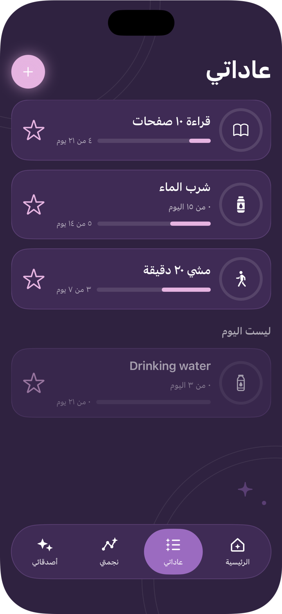
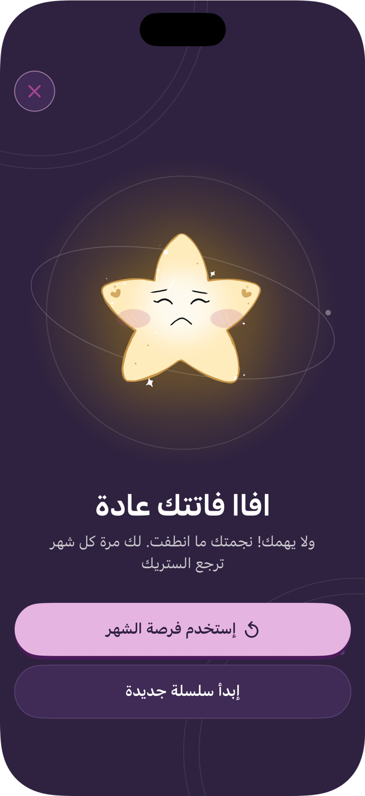
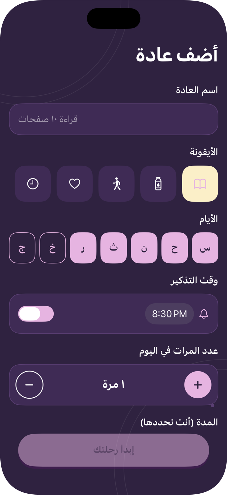
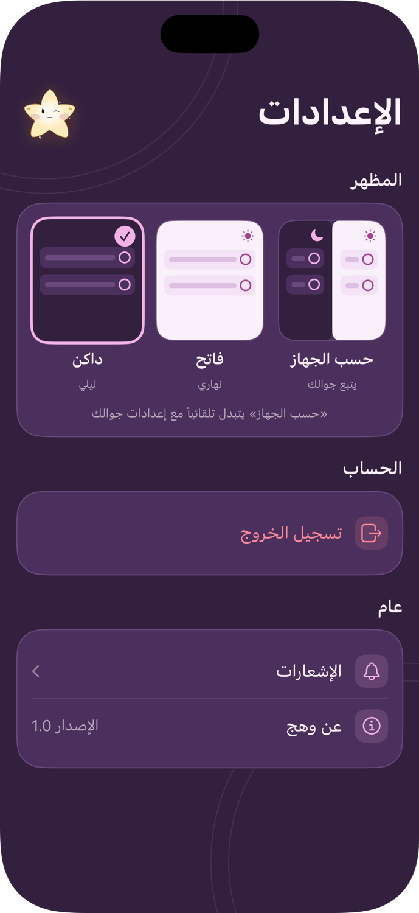
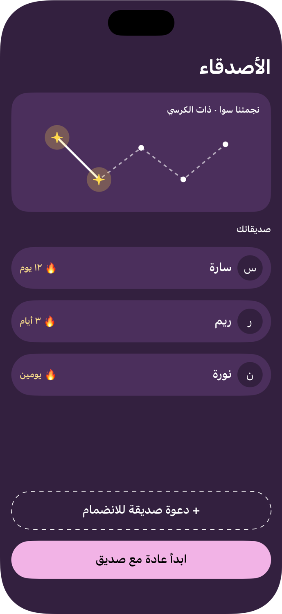
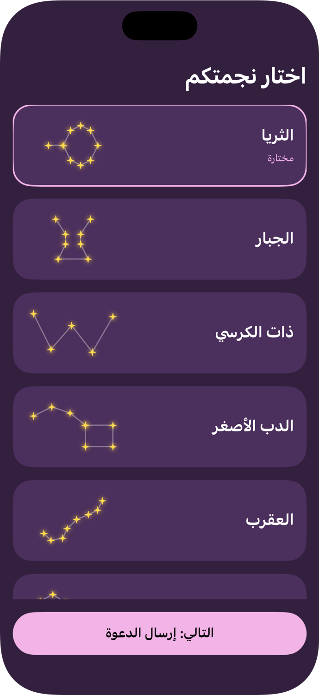
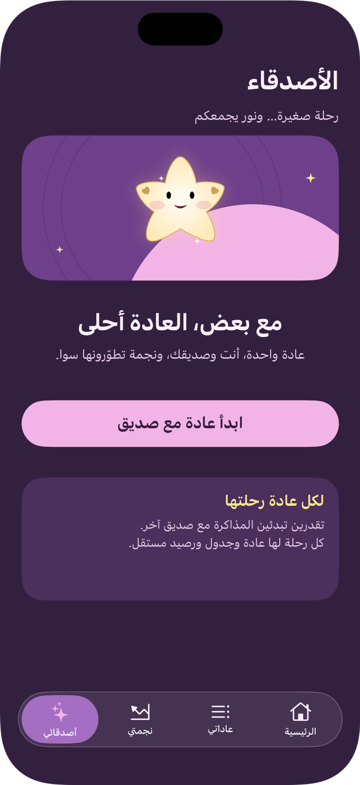
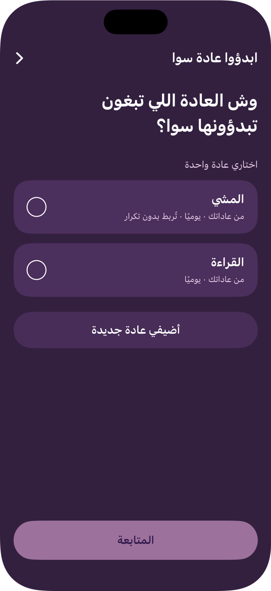

<div align="center">

# Wahj (وهج)

**Every habit you complete earns a star. Your stars build real constellations.**


A habit-tracking iOS app with a purple space theme, in light and dark mode.
Miss a day and your star waits for you instead of going out.

</div>

---

## Screenshots

<table>
  <tr>
    <td align="center"><br><sub><b>My Habits</b><br>Lamis</sub></td>
    <td align="center"><br><sub><b>Missed Habit</b><br>Lamis</sub></td>
    <td align="center"><br><sub><b>Add Habit</b><br>Lamis</sub></td>
    <td align="center"><br><sub><b>Settings</b><br>Lamis</sub></td>
  </tr>
  <tr>
    <td align="center"><br><sub><b>Friends</b><br>Mays</sub></td>
    <td align="center"><br><sub><b>Choose a Constellation</b><br>Mays</sub></td>
    <td align="center"><br><sub><b>Friends Home</b><br>Zaha</sub></td>
    <td align="center"><br><sub><b>Start a Habit Together</b><br>Zaha</sub></td>
  </tr>
</table>

More screens are added as the team finishes them. Screenshots live in `docs/screenshots/`.

## About

**Challenge:** Help people who struggle with daily routines stay motivated and complete their daily tasks consistently.

**Our answer:** Wahj turns daily tasks into a game for young adults and busy people. Other habit apps only track habits. Wahj adds streaks, rewards and friends, so doing your habits feels rewarding and not like a chore.

## Features

- Mark a habit as done to earn a star
- Stars build constellations: Big Dipper, Orion, Cassiopeia and Scorpius
- Daily streaks, with a monthly "streak saver" when you miss a day
- Create habits with an icon, days, a reminder and a duration
- Do habits with friends, invite them from the iOS share sheet and see their progress
- Arabic, right-to-left, light and dark mode

## Getting started

```bash
git clone https://github.com/lolo67fa/wahj.git
```

Open `tawhj.xcodeproj` in Xcode, pick an iPhone simulator and press **Cmd + R**.

## Project structure

```
wahj/
├── Lamis/            My Habits, Missed Habit, Add Habit, Settings
├── Lujain/           Home, first star, completed constellation
├── Mays/             Friends screens
├── Zaha/             Friends screens
├── Shared/           Theme, StarryBackground, BottomTabBar
├── docs/screenshots/ README screenshots
├── Assets.xcassets   Images, tab bar icons and colors
├── MyApp.swift       App entry point
└── tawhj.xcodeproj   Xcode project
```

Each person works in their own folder. Files in `Shared/` are used by everyone, so tell the group before changing them.

## How we work

1. `git pull` before you start.
2. Only edit files in your own folder.
3. Commit with a short message that starts with a verb, like `Add Missed Habit page`.
4. `git push` at the end of each session.

> **Xcode:** a new file must be added to the Xcode project, not only copied into the folder, or it will not build. There is only one `@main` file (`MyApp.swift`).

> **Screenshots:** save a PNG in `docs/screenshots/` with a lowercase name and dashes (`my-habits.png`), then add a cell to the table above.

## Design

- [Figma design](https://www.figma.com/design/mYQ0TEcEO8A8MxJhZ3nzjY/Wahj?node-id=1-1322&t=43R1Los8qkt5NdsL-1)
- Miro board: _add the link here_

Colors are Color Sets in `Assets.xcassets` (named `ThemeBg`, `ThemePink` and so on), each with a Light and a Dark version. `Shared/Theme.swift` gives them short names. Use the name (like `Theme.pink`) in code, never a hex code or `.white`, so every screen follows light and dark mode. Light colors come from Figma.

| Light | Dark | Name | Used for |
|:---:|:---:|---|---|
|  `#FAF0FB` |  `#2F2240` | `Theme.bg` | Screen background |
|  `#F4E3F6` |  `#3F2B55` | `Theme.card` | Cards, buttons, tab bar |
|  `#DDBFE2` |  `#5A3F73` | `Theme.border` | Borders and thin lines |
|  `#A0448F` |  `#E6B4E1` | `Theme.pink` | Buttons, progress bars, icons |
|  `#FFF6D6` |  `#FBEFC8` | `Theme.cream` | Selected icon background |
|  `#E6C4E6` |  `#9B6BC0` | `Theme.tabActive` | Selected tab |
|  `#38204A` |  `#FFFFFF` | `Theme.text` | Text and icons (use instead of `.white`) |
|  `#FFFFFF` |  `#2F2240` | `Theme.onAccent` | Text on pink buttons |
|  `#F2B544` |  `#FFD60A` | `Theme.starLit` | Filled star |

`Theme.decorLine` and `Theme.decorDot` are used by `StarryBackground`. The light/dark choice is saved with `@AppStorage("appearance")` and applied in `MyApp.swift`.

## Team

| Member | Screens | GitHub |
|---|---|---|
| Ghala | Sign in, appearance, name, welcome, first-time experience | [@lolo67fa](https://github.com/lolo67fa) |
| Ghaida | Daily habits flow: create a habit, set a duration, mark as done | [@Ghhaidaa](https://github.com/Ghhaidaa) |
| Lujain | Home, first star, completed constellation, Stars design artist| [@lujainayman1602-ux](https://github.com/lujainayman1602-ux) |
| Lamis | My Habits, Missed Habit, Add Habit, Settings | [@xtvkyx](https://github.com/xtvkyx) |
| Mays | Friends: home, choose a habit, choose a constellation, invitation, progress | [@maysAlh](https://github.com/maysAlh) |
| Zaha | Friends: home, choose a habit, choose a constellation, invitation, progress | [@zaha7](https://github.com/zaha7) |

Final step: connect all screens with `NavigationStack` and run the app on an iPhone.
